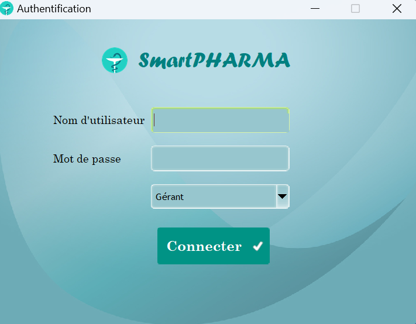
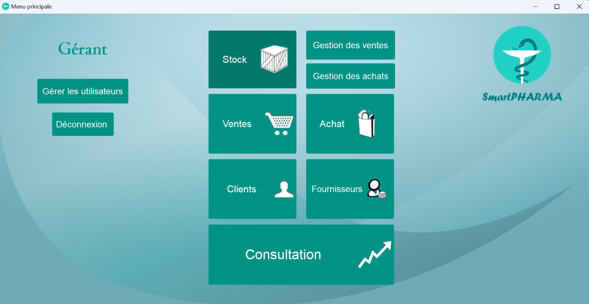
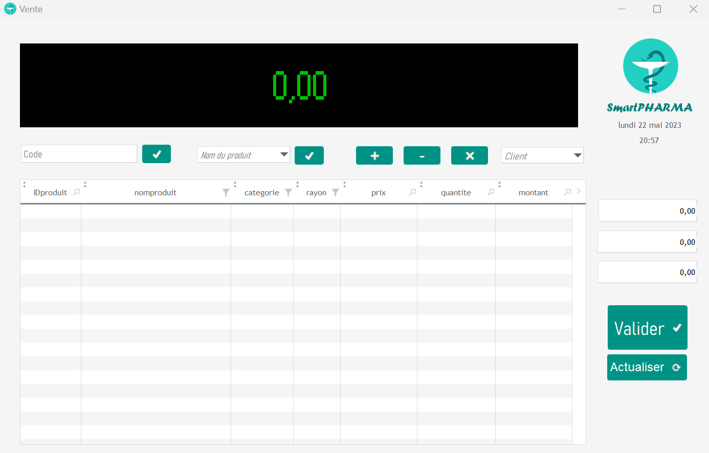
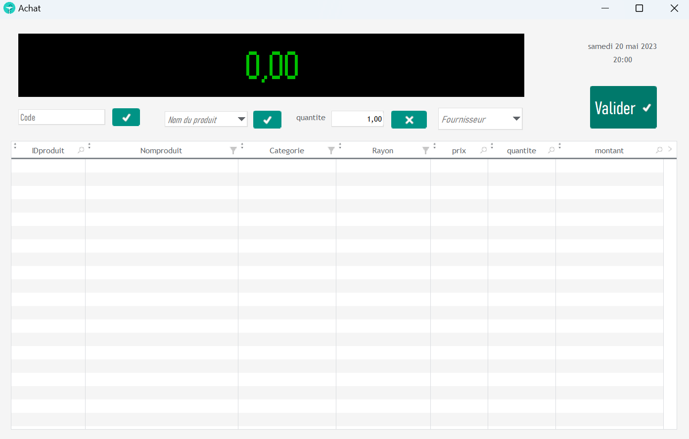
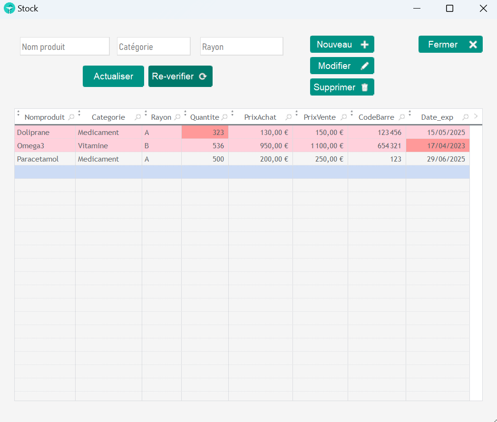
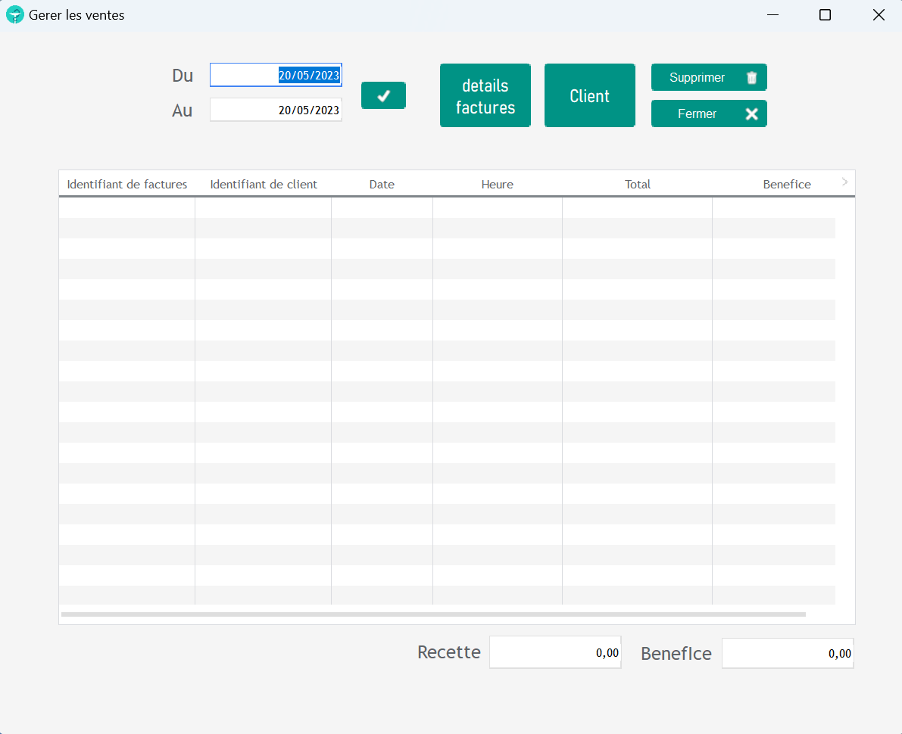
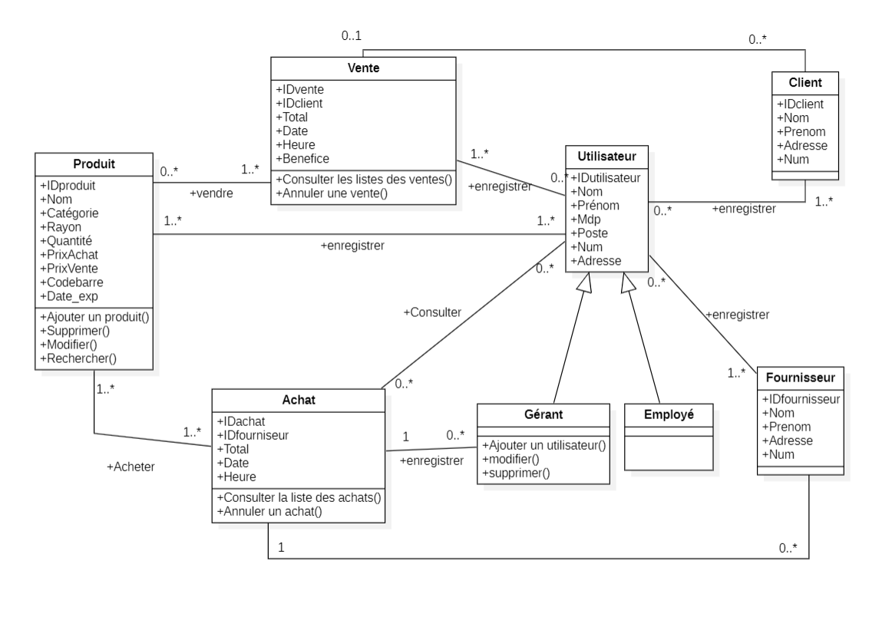

<p align="center"></p>

<h1 align="center">SmartPharma</h1>

<p align="center">
  Application de bureau de gestion de pharmacie : stock, ventes, achats, clients, fournisseurs et statistiques.<br>
  <b>Projet de fin d'études de Licence</b> (Licence Informatique, 2022/2023).
</p>

<p align="center">
  <a href="README.md">🇬🇧 English</a> · 🇫🇷 Français
</p>

---

## À propos

SmartPharma est une application Windows destinée à remplacer les registres papier d'une pharmacie par un outil unique. Elle a été conçue et développée dans le cadre de mon projet de fin d'études de Licence à la Faculté des Mathématiques et d'Informatique de l'USTO-MB (Oran, Algérie), spécialité *Systèmes Informatiques*.

Le projet couvre tout le cycle de développement : analyse des besoins, modélisation UML, conception de la base de données, implémentation et tests.

## Fonctionnalités

- **Authentification** avec deux rôles : *Gérant* et *Employé*.
- **Gestion du stock** : ajout, modification, suppression et recherche de produits (catégorie, rayon, quantité, prix d'achat et de vente, code-barres, date de péremption). Les produits en rupture ou proches de la péremption sont mis en évidence.
- **Ventes** : écran de type caisse (code-barres ou nom du produit, quantités, client, total), génération de factures et impression de tickets.
- **Achats** : commandes fournisseurs qui mettent à jour le stock à la validation.
- **Fiches clients et fournisseurs**.
- **Historique des ventes** par période, avec recette et bénéfice.
- **Statistiques** : évolution des ventes par jour, mois et année.
- **Gestion des utilisateurs** (réservée au gérant).

## Captures d'écran

| Connexion | Menu du gérant |
|---|---|
|  |  |

| Vente | Achat |
|---|---|
|  |  |

| Stock | Gestion des ventes |
|---|---|
|  |  |

Autres : [menu employé](docs/screenshots/03-employee-menu.png) · [statistiques de ventes](docs/screenshots/08-sales-statistics.png)

> Les données visibles sur les captures sont des données de test.

## Conception (UML)

L'application a été modélisée en UML avant son développement (diagrammes réalisés avec StarUML).

| Diagramme | Fichiers |
|---|---|
| Cas d'utilisation | [authentification](docs/uml/use-case-authentication.png) · [employé](docs/uml/use-case-employee.png) · [gérant](docs/uml/use-case-manager.png) |
| Séquence | [authentification](docs/uml/sequence-authentication.png) · [vente](docs/uml/sequence-sale.png) · [gestion des utilisateurs](docs/uml/sequence-user-management.png) |
| Classes | [class-diagram.png](docs/uml/class-diagram.png) |



Les principales entités sont `Produit`, `Vente`, `Achat`, `Client`, `Fournisseur` et `Utilisateur` (spécialisé en `Gérant` et `Employé`).

📘 Détails complets (rôles, flux de l'application, dictionnaire de données, modèle relationnel, en anglais) : **[docs/ARCHITECTURE.md](docs/ARCHITECTURE.md)**

## Technologies

| Domaine | Outil |
|---|---|
| IDE / framework | WinDev 25 (PC SOFT) |
| Langage | WLangage, SQL |
| Base de données | HFSQL (intégrée) |
| Modélisation | UML, StarUML |

## Structure du dépôt

```
SmartPharma/
├── src/        Projet WinDev : fenêtres (FEN_*.wdw), requêtes (REQ_*.WDR),
│               état (ETATticket.wde), analyse de la base (BDD.ana), images
├── docs/       logo, captures d'écran, diagrammes UML
├── LICENSE     MIT
└── README.md
```

## Lancer le projet

**Ouvrir les sources** (nécessite [WinDev 25](https://windev.com) ou compatible) :

1. Cloner ce dépôt.
2. Ouvrir `src/PHARMACIEapp.wdp` dans WinDev.
3. Les fichiers de données HFSQL ne sont volontairement **pas** inclus : la base est recréée à partir de l'analyse (`src/BDD.ana`) à l'exécution. Il faut créer un premier compte utilisateur pour se connecter.

**Exécutable** : télécharger `SmartPHARMA.exe` depuis la page [Releases](../../releases). Il est fourni tel quel et nécessite les bibliothèques d'exécution WinDev.

## Remarques

- Ce dépôt ne contient **aucune donnée réelle** : les fichiers clients, fournisseurs et utilisateurs ont été exclus.
- Le mémoire n'est pas publié en entier ; un court résumé du projet est donné ci-dessus.
- Les fichiers WinDev sont dans des formats propriétaires : GitHub n'affiche donc pas de coloration syntaxique pour ce code.

## Améliorations possibles

- Prise en charge des cartes d'assurance maladie (CHIFAA, CNAS).
- Application mobile Android et iOS complémentaire.
- Mots de passe hachés et sauvegardes automatiques.

## Licence

Distribué sous [licence MIT](LICENSE).
